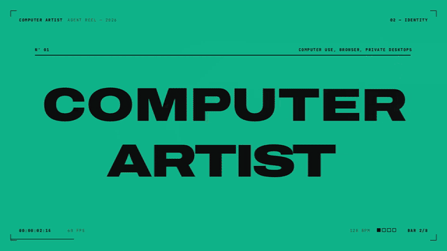
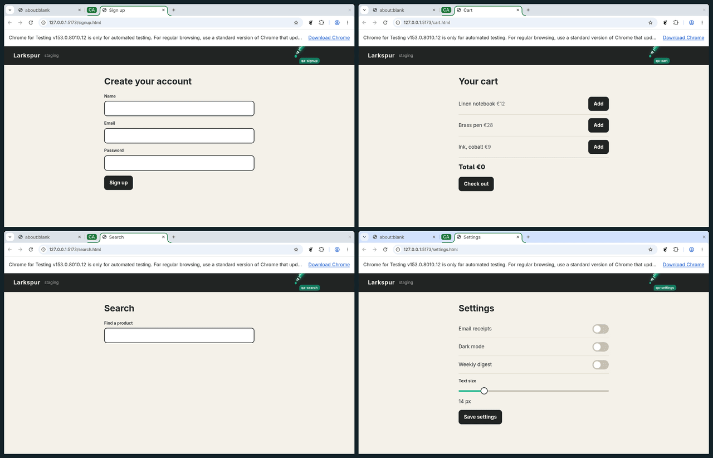
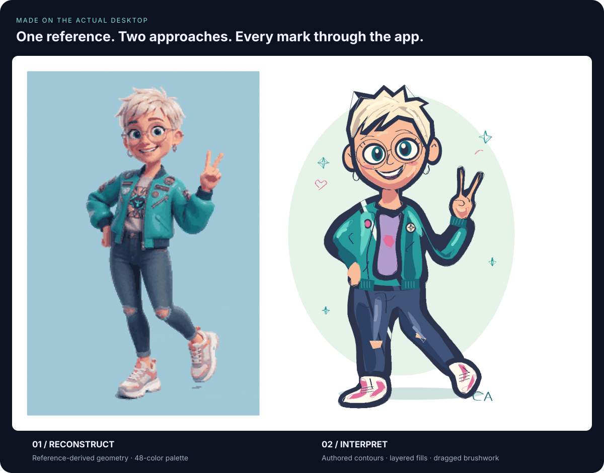
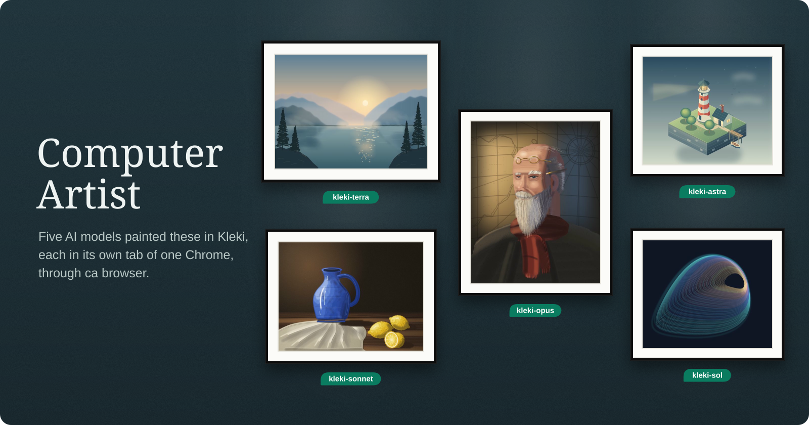
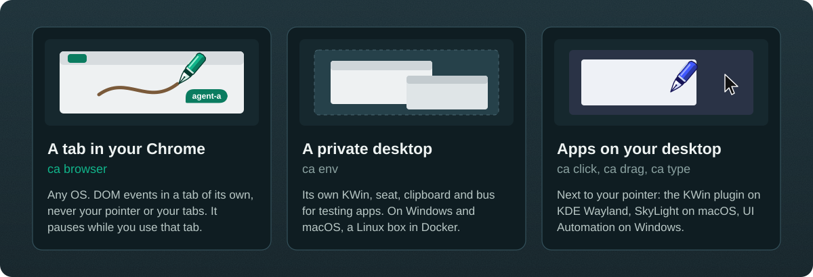
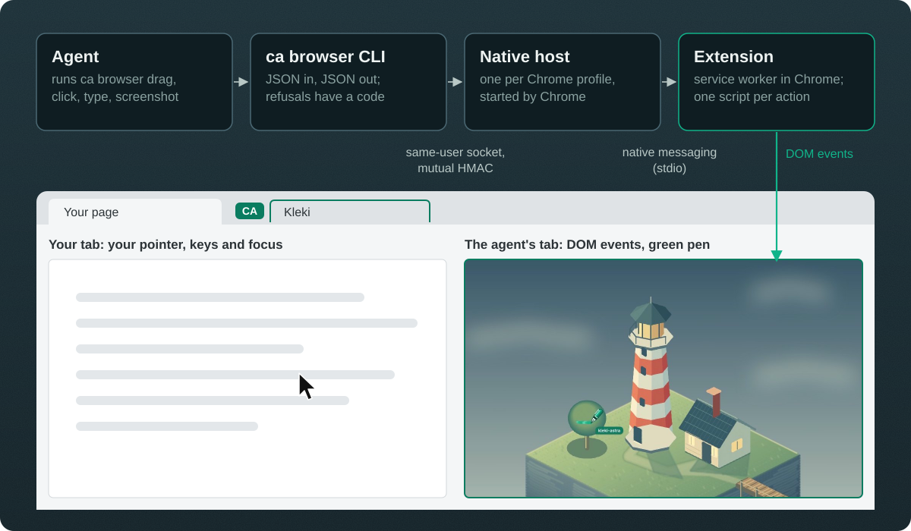

<p align="center">
  <a href="docs/assets/computer-artist-reel.mp4?raw=true"></a>
</p>

# Computer Artist

**Give your agents a pointer of their own.** Computer Artist is a local CLI, `ca`,
that lets AI agents see and operate real GUI apps: a tab in your Chrome, a private
desktop of their own, or the apps on your screen while you keep using yours. They
act, check what happened, remember what worked, and hand the app back.

<a href="docs/assets/computer-artist-reel.mp4?raw=true">Watch the reel</a> (15 s, sound on) ·
[The agent skill](skills/computer-artist/SKILL.md) ·
[Capabilities](docs/CAPABILITIES.md) ·
[Gallery](docs/GALLERY.md)

## Why

- **Real apps, no API needed.** Desktop apps, games, canvas editors and web apps
  are used the way people use them: windows, menus, fields, drags.
- **Never in your way.** On your desktop the agent drives its own pointer and keys;
  in Chrome it works in its own tab. Your click or key takes the app back.
- **Many at once.** One private desktop or one tab per agent, each tagged with its
  name, so several agents test different features of the same app in parallel.
- **Checked, not assumed.** Programs verify their own outcome, and agents read the
  result back from the app, a screenshot or a file.
- **Learned once, reused.** A verified run becomes a workflow memory the next agent
  can reuse: one paired KolourPaint run took 53.9 s to discover and 19.5 s to reuse.

## What it's for

### Test a web app's features in parallel

Each agent opens its own tab in the browser you already run, works there with DOM
events, and screenshots its own result. Your tabs, pointer and focus stay yours;
a green pen with the agent's name shows where it works.

```bash
ca browser open http://localhost:5173/signup --owner qa-signup
ca browser open http://localhost:5173/cart --owner qa-cart
ca browser type --tab HANDLE --lease LEASE --text Email "ada@example.com"
ca browser screenshot --tab HANDLE signup.png
```

<p align="center">
  
  <br><sub>Four scripted agents test four features of a local test site at once, one tab each, filmed in a private desktop.</sub>
</p>

### Debug desktop apps and games in private desktops

`ca env start` gives an agent a desktop of its own: its own KWin, seat, clipboard
and session bus, with the app on the host or in a Podman or Docker container. Run
one per build or per bug, read the accessibility tree, capture and watch frames, and
throw it away afterwards. On Windows and macOS the desktop is a Linux box in Docker
Desktop.

```bash
ca env start game-qa
ca env exec game-qa --name game --wait-window -- ./build/my-game
ca --environment game-qa observe --window game
ca --environment game-qa watch --window game --interval 0.2 --changes-only
ca env stop game-qa
```

### Work next to you on your own desktop

On KDE Wayland the KWin plugin gives the agent an independent pointer and keyboard
in supported native Wayland apps, so it can draw in one app while you type in
another. macOS delivers the agent's pointer through SkyLight and Windows uses UI
Automation, each with a drawn pen. On KDE you take an app back by moving into it.

<p align="center">
  
  <br><sub>Drawn in KolourPaint on a KDE desktop through the KWin lane, with an earlier revision.</sub>
</p>

### Automate apps that have no API

`ca execute` runs a Python program against a window with a hard deadline, a request
budget and its own checks. `--remember` keeps a verified run as a workflow memory
that a later agent finds with `ca memory search` and adapts when the app changed.

```bash
ca execute --window APP --remember export-report --task "Export the weekly report" \
  --app "APP" --notes "Starting state, steps, inputs, pitfalls and success checks" < workflow.py
ca memory search "export report" --app APP
```

### Draw

Paint apps and chemistry structure editors took multi-point drags, modifiers and
wheel events like real input in recorded tests. Five models painted these in Kleki,
each in its own tab of one Chrome, through `ca browser` alone.

<p align="center">
  <a href="docs/GALLERY.md"></a>
  <br><sub><a href="docs/GALLERY.md">The gallery</a>: every work with its model, counts, time-lapse and how it was made.</sub>
</p>

## Ideas you might not expect

Most of these haven't been recorded as tests yet; each uses only what `ca` already
does.

- **Release notes that film themselves.** An agent walks through a new feature in its
  own tab, and its screenshots, pen included, become the GIF in your changelog. The
  gallery's time-lapses were made this way.
- **Model bake-offs on real interfaces.** Give several models the same GUI task in
  their own tabs or desktops, and compare their input actions, minutes and results,
  as the [gallery run](docs/validation/2026-11-05-kleki-gallery.md) did.
- **From bug report to reproduction.** Paste an issue; an agent rebuilds the steps
  in a fresh private desktop and attaches the frames it captured at each step.
- **Persona sweeps.** Five agents use the same build as five kinds of user (keyboard
  only, first visit, power user, tiny window, slow typist), all at once.
- **An accessibility pass.** `ca a11y --window APP` lists the roles and names an app
  exposes (verified for Qt; GTK and browser trees are not yet); an agent flags the
  unnamed buttons and retries the flow from the keyboard.
- **A screen-size matrix.** The same flow in private desktops at 1280×720,
  1920×1080 and 2560×1440 (`ca env start --width --height`), side by side.
- **Screenshots for translators.** Start a private desktop with another locale
  (`--env LANG=de_DE.UTF-8` on a container app) and capture every screen.
- **A guided tour in your own browser.** An agent shows a colleague a workflow in
  their Chrome: the green pen glides to each control, and the tab says
  "Back to you" when it lets go.
- **A babysitter for long jobs.** `ca watch --changes-only` follows a long render or
  import, and the agent hands over when a dialog needs a person.
- **A bridge to legacy software.** The old desktop app with no API becomes a nightly
  `ca execute` job that checks its exported file before it reports success.

## Get started

Requires Python 3.12 or later.

```bash
python -m venv .venv && source .venv/bin/activate
pip install -e .
ca doctor              # what works here, without sending input
ca setup --codex       # install the agent skill
```

The skill in [`skills/computer-artist/SKILL.md`](skills/computer-artist/SKILL.md) is
what your agent reads: it picks the lane (browser tab, private desktop or your own
desktop) and follows that lane's steps. Re-run setup to update managed copies.

| Lane | Platforms | Start here |
| --- | --- | --- |
| A tab in your Chrome or Chromium | Any OS | `ca browser install`, then load the printed folder in `chrome://extensions`; see [Browser extension](docs/BROWSER.md). Pages that need trusted gestures refuse its events |
| A private desktop | Linux (host apps, Podman or Docker); Windows and macOS through Docker Desktop | `ca env start NAME`; see [Private environments](docs/ENVIRONMENTS.md) |
| Your own desktop | Linux / KDE Wayland | A loaded KWin plugin built from this checkout; see [Linux installation](docs/INSTALL.md). XWayland input is unsupported |
| Your own desktop | Windows | Standard-control messages and UI Automation; see [Windows](docs/WINDOWS.md). No drawing, drags or general shortcuts |
| Your own desktop | macOS | SkyLight pointer delivery and process-targeted keys; see [macOS](docs/MACOS.md). App compatibility and drags vary |

Installing the Python package or the skill does not deploy the KWin plugin.
`ca doctor` reports a missing, stale or mismatched plugin.

## How it works

<p align="center">
  
</p>

**In Chrome**, `ca browser` talks to a native host over a same-user socket with
mutual HMAC, and the host relays to the extension, which runs each action as DOM
events in the agent's own tab. It never moves your pointer or starts a browser, and
it switches tabs only for an explicit `ca browser focus`, which also takes window
focus. On Linux with Wayland (tested with Chrome for Testing 153), background tabs
could not be rendered, so a screenshot needs the tab on screen: open it with
`--agent-window` or `focus` it.

<p align="center">
  
</p>

**In a private desktop**, every command carries `--environment NAME`, and the
default lane drives that desktop's own seat, never yours. A stopped or missing
environment is an error, not a fallback to your desktop.

**On your desktop**, bind an exact window with `ca set WINDOW_ID --name APP` and
rebind after reopening. Coordinates are logical content pixels on Linux, physical
client pixels on Windows and whole-window-frame points on macOS. `ca session close`
removes the drawn pen afterwards.

**Programs and memory.** Programs define `run(ctx)`, with conditions, loops, waits,
paths, SVG path data, handoff and file checks; invocation-owned checks establish a
`verified` outcome, which the agent still confirms in the app. A memory keeps
notes, a source snapshot and outcome summaries, not your screenshots or files; its
fast path checks the app's identity, title and size first, and anything that
changed needs the agent's judgment. Search matches local words, not a model. This
is agent-assisted learning from runs, not recording of your desktop. See
[CLI programs](docs/PROGRAMS.md) and [workflow memory](skills/computer-artist/references/memory.md).

```bash
ca runs list
ca runs inspect RUN_ID
ca storage keep RUN_ID
```

In a checkout, `window/workflows/` holds memories, `window/api-fragmants/` versioned
fragments, `window/layout/` window maps and `output/` bounded run evidence; five
eligible runs rotate by default, so save final documents elsewhere.

## Input boundaries

On KDE, keep your pointer and keyboard focus outside the agent's target connection;
returning revokes its control. In Chrome, your input in a claimed tab ends the
agent's lease. The agent lane never falls back to moving your pointer or stealing
focus. `--host` explicitly selects real desktop input, and macOS `--host-drags`
borrows your mouse for each drag; both need specific authorization and neither is
an automatic recovery path.

Programs have your user permissions, and input separation is not a security
sandbox. Private environments are test harnesses; the product goal is independent
input in applications on your actual desktop.

## Documentation

- [The agent skill](skills/computer-artist/SKILL.md) and its [references](skills/computer-artist/references)
- [Capabilities and remaining work](docs/CAPABILITIES.md)
- [Browser extension](docs/BROWSER.md) and [private environments](docs/ENVIRONMENTS.md)
- [Recorded validation](docs/VALIDATION.md), the [Kleki gallery](docs/GALLERY.md) and the [workflow-memory benchmark](docs/WORKFLOW-MEMORY-BENCHMARK.md)
- [Code structure](docs/CODE-STRUCTURE.md) and [socket protocol](docs/PROTOCOL.md)
- [Contributing](CONTRIBUTING.md) and [test scope](tests/README.md)
- [How the reel is made](docs/reel/README.md): canvas code, a synthesized soundtrack and ffmpeg

On Linux, `ca update` pulls the checkout, rebuilds and reloads the KWin plugin;
`ca update --check` reports the plan. Read the
[update precautions](docs/INSTALL.md#updating) before changing a running
compositor. [GPL-2.0-or-later](LICENSE).
