<p align="center">
  
</p>

Computer Artist gives agents a local CLI to observe and operate GUI apps, check
the result, and remember the workflow. An agent works in its own tab of your
Chrome, in a private desktop, or in apps on your own desktop next to your pointer.

<p align="center">
  <a href="docs/assets/kleki-promo.mp4?raw=true">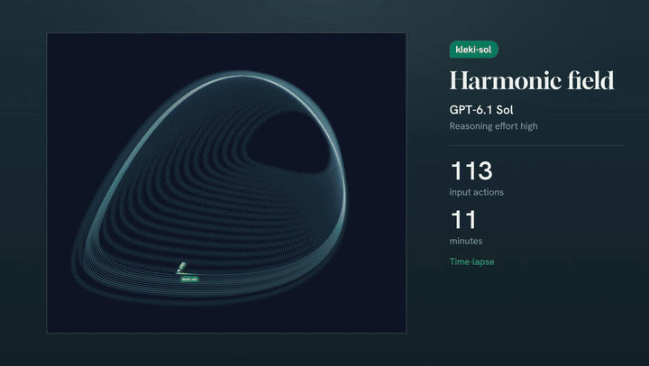</a>
  <br><sub><a href="docs/assets/kleki-promo.mp4?raw=true">Watch the 56-second film</a> (MP4 download, 1080p, 5.7 MB)</sub>
</p>

## Five models, one browser

On 5 November 2026 five models each painted one commission in [Kleki](https://kleki.com), each in its own tab of one Chrome, only through `ca browser`: DOM pointer events, screenshots, and a green pen that carries the agent's name. The green tag under each painting is that name. The coordinator judged every result and sent weak ones back. The [run record](docs/validation/2026-11-05-kleki-gallery.md) has the setup, counts, send-backs and every error.

<p align="center">
  <a href="docs/assets/gallery/terra.jpg">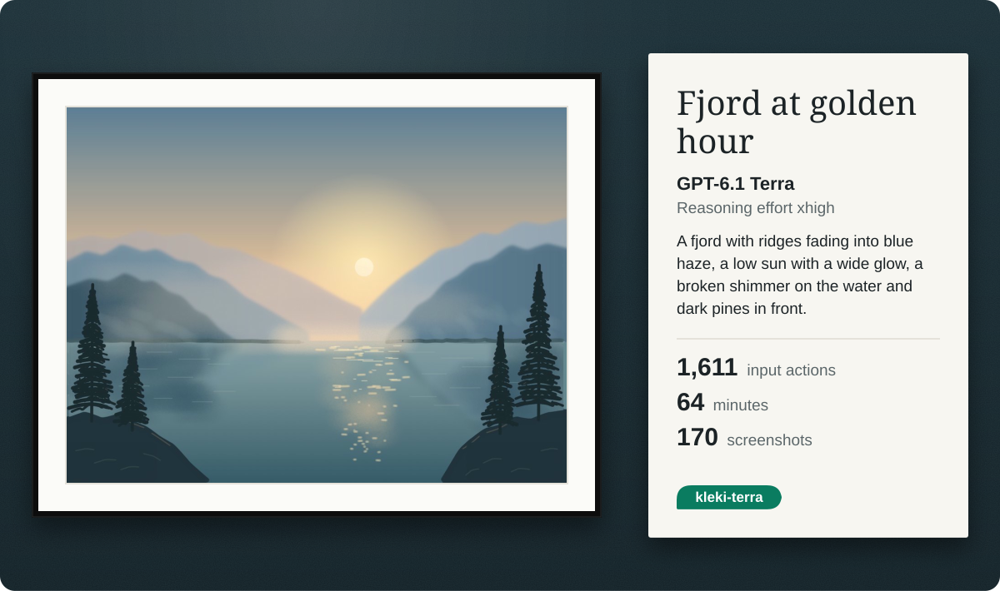</a>
</p>

**Fjord at golden hour** by GPT-6.1 Terra, reasoning effort xhigh: 1,611 input actions in 64 minutes. Kleki's linear and radial gradients make the sky and the sun's glow; separate ridge layers are softened with blur, and the reflections are mirrored from the ridge coordinates at 40% opacity. The first pass came back after 7.5 minutes as flat bands; it was sent back three times.

<p align="center">
  <a href="docs/assets/gallery/astra.jpg">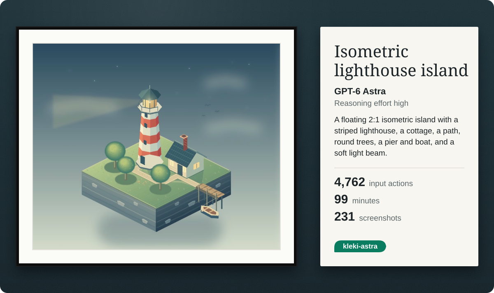</a>
</p>

**Isometric lighthouse island** by GPT-6 Astra, reasoning effort high: 4,762 input actions in 99 minutes. Every vertex comes from one projection, P(x, y, z) = (600 + 40(x − y), 440 + 20(x + y) − z), painted on 12 layers. One short round darkened the right face, replaced scribbles with strata and laid the path. Astra titled it *The Last Light*.

<p align="center">
  <a href="docs/assets/gallery/sol.jpg">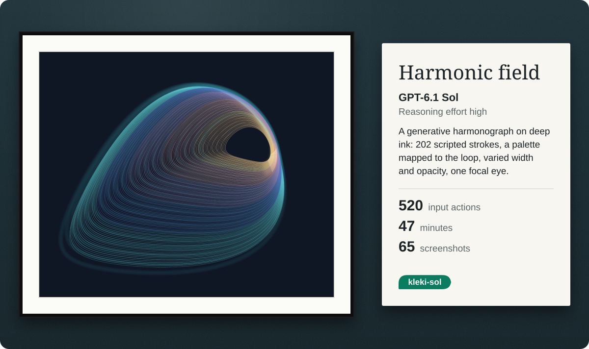</a>
</p>

**Harmonic field** by GPT-6.1 Sol, reasoning effort high: 520 input actions in 47 minutes. 202 scripted strokes on five layers: a soft underpainting, fine loops coloured along the curve, offset interference and gold glints at the cusp. The only piece accepted on its first delivery.

<p align="center">
  <a href="docs/assets/gallery/opus.jpg">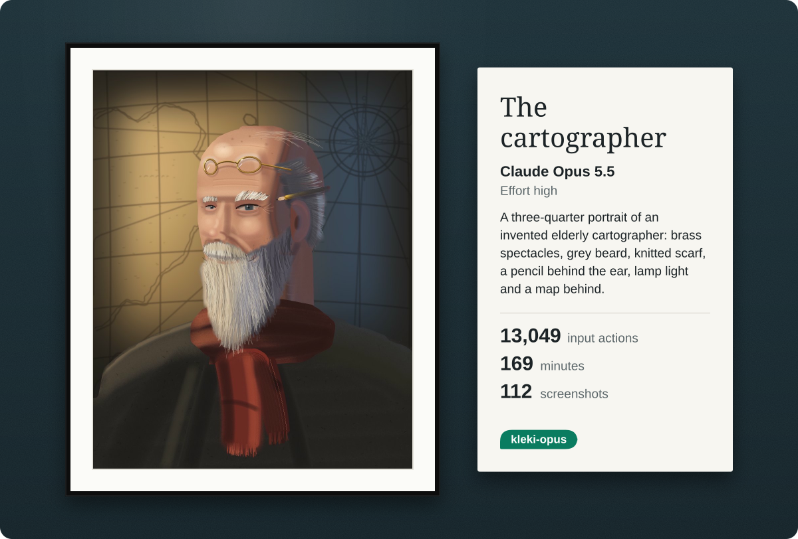</a>
</p>

**The cartographer** by Claude Opus 5.5, effort high: 13,049 input actions in 169 minutes. The head was laid out by script first (eye line at half height, the far eye narrower), then modelled with soft strokes at 15–35% opacity; the beard, hair and eyebrows are thousands of 1–2 px strands. A second round added the knowing smile, the cool shadow side and the scarf's knot.

<p align="center">
  <a href="docs/assets/gallery/sonnet.jpg">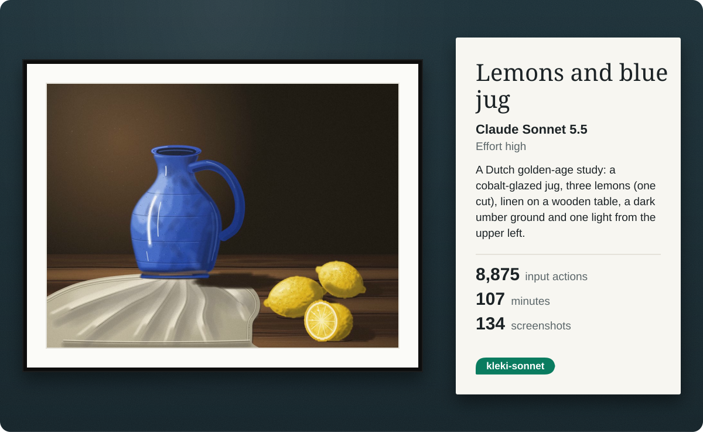</a>
</p>

**Lemons and blue jug** by Claude Sonnet 5.5, effort high: 8,875 input actions in 107 minutes. A small numpy lighting model (a cylinder for the jug, dimpled ellipsoids for the lemons) became rows of soft strokes, melted with Kleki's blur; speculars and the cut lemon's segments are placed by hand. This is the second version: a third, linen-only round came out worse and was discarded.


<p align="center">
  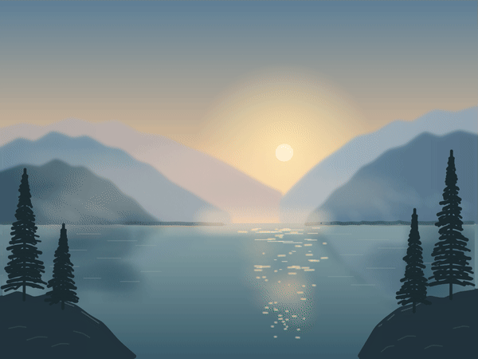
  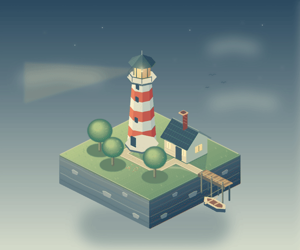
  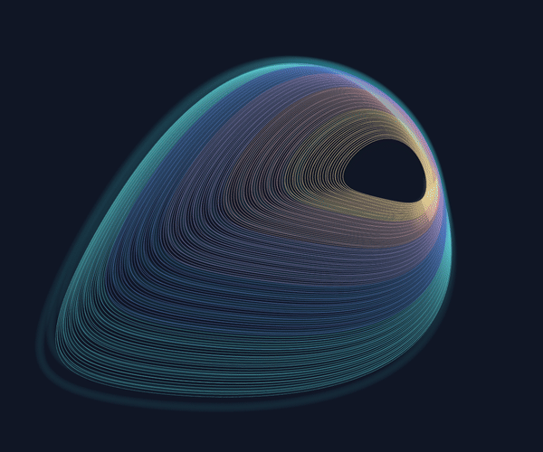
  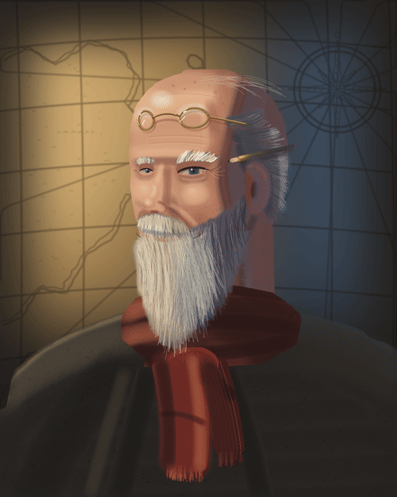
  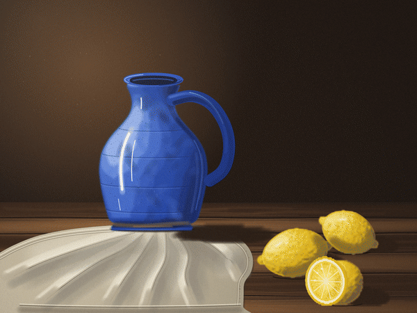
</p>
<p align="center"><sub>Time-lapses from each tab, filmed with <code>ca browser screenshot</code> while the artists worked.</sub></p>

<p align="center">
  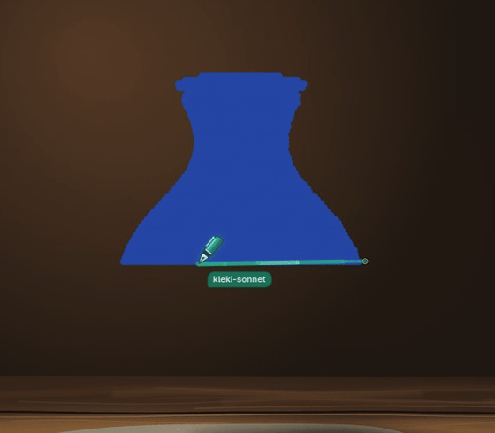
  <br><sub>The pen at work: kleki-sonnet fills the cobalt jug, in 25 real captures from its tab.</sub>
</p>

<p align="center">
  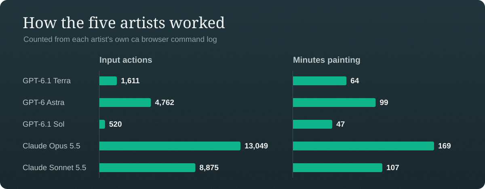
</p>

## How `ca browser` works

<p align="center">
  
</p>

```bash
ca browser install                                   # native host; then Load unpacked the printed folder
ca browser open https://kleki.com --owner painter    # your own tab: a handle and a lease
ca browser screenshot --tab HANDLE 01.png            # reports the viewport for coordinates
ca browser drag --tab HANDLE --lease LEASE --viewport 1700x1291 \
  --from 200 300 --via 400 250 --to 600 320          # refused if the viewport changed
ca browser release --tab HANDLE --lease LEASE        # hand the tab over to you
```

Actions are DOM events inside the page: `ca browser` never moves your pointer,
switches your tabs or starts a browser. Your own click, key or scroll in a
claimed tab takes it back. See [the browser extension](docs/BROWSER.md).

## Where the agent works

<p align="center">
  
</p>

Requires Python 3.12 or later.

| Platform | Native desktop input | Installation and limits |
| --- | --- | --- |
| Linux / KDE Wayland | KWin plugin delivers independent pointer and physical-key events to supported native Wayland apps | [Linux installation](docs/INSTALL.md); XWayland input is unsupported |
| Windows | Targeted standard-control messages and UI Automation, with a separately drawn pen | [Windows](docs/WINDOWS.md); the agent lane does not support drawing, drags or general shortcuts |
| macOS | Private SkyLight pointer delivery, process-targeted physical keys and a separately drawn pen | [macOS](docs/MACOS.md); application compatibility and drag behavior vary |
| Chrome or Chromium, any OS | DOM events in the agent's own tab through the Computer Artist extension | [Browser extension](docs/BROWSER.md); pages that need trusted gestures refuse them |

`ca doctor` reports backend readiness without sending input. Linux needs a
matching loaded KWin plugin; installing the Python package or agent skill does not
deploy it. `ca setup --codex` installs the bundled agent instructions: a source
link on Linux/macOS, or a managed copy on Windows. Re-run setup to update managed
copies.

For development and testing, use a private desktop. On Linux, apps run from the
host or Podman/Docker; Windows and macOS need Docker Desktop and run Linux apps in
a box. This example needs KWrite on the Linux host; box images include it:

```bash
ca env start demo --project .
ca env exec demo --name editor --wait-window -- kwrite
ca --environment demo observe --window editor
ca env stop demo
```

Keep `--environment demo` on every command for that desktop: its default lane
drives the private desktop's own seat, not yours. See
[private environments](docs/ENVIRONMENTS.md) for recipes, browsers, profiles and
evidence paths; Linux-only `--image IMAGE` is not supported by the Windows/macOS
box backend.

## Remember and reuse workflows

```bash
ca memory search "export report" --app APP
ca memory show NAME
ca memory run NAME --window APP --args '{}'
ca execute --window APP --remember NAME --task "TASK" --app "APP" \
  --notes "Starting state, steps, inputs, pitfalls and success checks" < workflow.py
```

The agent reads a memory, inspects the current UI and decides whether the stored
procedure fits. A fast path checks the app identity, title and dimensions first; a
mismatch needs fresh inspection, and canvas contents or redesigned controls still
need the agent's judgment. Search matches local words in task, app and notes; it
is not a model call. Automatic learning keeps an existing memory after a failed or
unverified attempt, and memories keep notes, a source snapshot and outcome
summaries, not your screenshots or exported files. This is agent-assisted
learning from runs, not passive recording of your desktop. See
[workflow memory](skills/computer-artist/references/memory.md); the
[painting benchmark](docs/WORKFLOW-MEMORY-BENCHMARK.md) measured 53.9 s to
discover, draw and learn a KolourPaint scene, then 19.5 s to reuse it, in one
paired run.

## Programs, controls and evidence

Programs define `run(ctx)` and run with a hard deadline, a shared request budget
and input cleanup. They support conditions, loops, waits, paths, SVG path data,
handoff and file checks, and invocation-owned checks establish a `verified`
outcome; the agent still inspects the actual result, since a program check is a
claim, not independent proof. Versioned fragments (`ca fragments`), guarded pixel
targets and layout maps remain available; prefer accessibility roles and names
when the app exposes them. See [CLI programs](docs/PROGRAMS.md).

Bind an exact live window with `ca set WINDOW_ID --name APP`, and rebind after
reopening. Coordinates are logical content pixels on Linux, physical client pixels
on Windows and whole-window-frame points on macOS. `ca session close` removes the
drawn pen after native-desktop work.

```bash
ca runs list
ca runs inspect RUN_ID
ca storage keep RUN_ID
```

In a checkout, `window/workflows/` holds memories, `window/api-fragmants/`
versioned fragments, `window/layout/` window maps and `output/` bounded run
evidence. Private desktops share memories and fragments with the main workspace
but keep their own names, maps and output. Five eligible runs rotate by default;
active and preserved runs are protected, so save final documents outside
`output/`. See [installation](docs/INSTALL.md) for installed-package paths.

## Input boundaries

On KDE, keep your pointer and keyboard focus outside the agent's target
connection; returning revokes its control. In Chrome, your input in a claimed tab
ends the agent's lease. The agent lane never falls back to moving your pointer or
stealing focus. `--host` explicitly selects real desktop input, and macOS
`--host-drags` borrows your mouse for each drag; both need specific authorization
and neither is an automatic recovery path.

Programs have your user permissions, and input separation is not a security
sandbox. Private environments are test harnesses; the product goal remains
independent input in applications on your actual desktop.

## Documentation

- [Capabilities and remaining work](docs/CAPABILITIES.md)
- [Browser extension](docs/BROWSER.md) and [private environments](docs/ENVIRONMENTS.md)
- [Recorded validation](docs/VALIDATION.md), the [Kleki gallery run](docs/validation/2026-11-05-kleki-gallery.md) and the [workflow-memory benchmark](docs/WORKFLOW-MEMORY-BENCHMARK.md)
- [Code structure](docs/CODE-STRUCTURE.md) and [socket protocol](docs/PROTOCOL.md)
- [Contributing](CONTRIBUTING.md) and [test scope](tests/README.md)

On Linux, `ca update` pulls the checkout, rebuilds and reloads the KWin plugin;
`ca update --check` reports the plan. Read the
[update precautions](docs/INSTALL.md#updating) before changing a running
compositor. [GPL-2.0-or-later](LICENSE).
