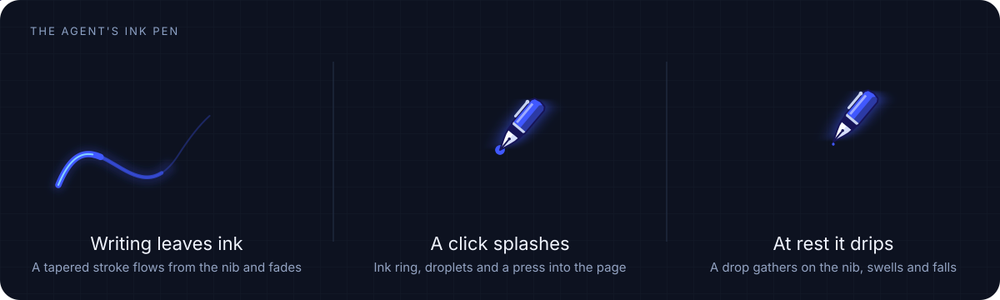

# Computer Artist

Computer Artist gives agents a local CLI for observing and operating supported
GUI applications, verifying outcomes, and remembering useful workflows. Supported
native backends let an agent work in one application while you use another.
Private desktops are available for development and testing.



## Install and choose a desktop

Requires Python 3.12 or later. Follow the instructions for your platform:

| Platform | Native desktop input | Installation and limits |
| --- | --- | --- |
| Linux / KDE Wayland | KWin plugin delivers independent pointer and physical-key events to supported native Wayland apps | [Linux installation](docs/INSTALL.md); XWayland input is unsupported |
| Windows | Targeted standard-control messages and UI Automation, with a separately drawn pen | [Windows](docs/WINDOWS.md); the agent lane does not support drawing, drags or general shortcuts |
| macOS | Private SkyLight pointer delivery, process-targeted physical keys and a separately drawn pen | [macOS](docs/MACOS.md); application compatibility and drag behavior vary |

`ca doctor` reports backend readiness without sending input. Linux needs a matching
loaded KWin plugin; installing the Python package or agent skill does not deploy it.
`ca setup --codex` installs the bundled agent instructions: a source link on
Linux/macOS, or a managed copy on Windows. Re-run setup to update managed copies.

For development and testing, use a private desktop. On Linux, apps can run from
the host or Podman/Docker; Windows and macOS require Docker Desktop and run Linux
apps in a box. This example needs KWrite installed on the Linux host; box images
already include it:

```bash
ca env start demo --project .
ca env exec demo --name editor --wait-window -- kwrite
ca --environment demo windows
ca --environment demo observe --window editor
ca env stop demo
```

Keep `--environment demo` on every command operating that desktop. Its default
host lane drives the private desktop's own seat, not your desktop. See
[private environments](skills/computer-artist/references/environments.md) for
recipes, additional apps, browsers, profiles and evidence paths. Linux-only
`--image IMAGE` is not supported by the Windows/macOS box backend.

## Remember and reuse workflows

Search before discovering the same task again:

```bash
ca memory search "export report" --app APP
ca memory show NAME
ca observe --window APP
ca memory run NAME --window APP --args '{}'
```

The agent reads the memory, inspects the current UI, and chooses whether its stored
procedure fits. A fast path checks the initial app identity, title and dimensions
before using the existing supervised runtime. A mismatch requires fresh inspection
and adaptation; selected tools, canvas contents and redesigned controls still need
the agent's judgment. Search matches local words in task/app/notes; it is not a
model call or automatic control discovery.

Learn an existing completed run with `ca memory learn NAME --run RUN_ID --task
"TASK" --app "APP" --notes "PROCEDURE"`, or remember a new program automatically:

```bash
ca execute --window APP --remember NAME --task "TASK" --app "APP" \
  --notes "Starting state, semantic steps, variable inputs, pitfalls and success checks" < workflow.py
```

Programs define `run(ctx)` and use invocation-owned checks to establish a
`verified` outcome. Automatic learning preserves an existing memory after a failed
or unverified attempt. The agent still inspects the actual result: a program check
is a claim, not independent proof. Memories retain notes, a source snapshot and
outcome summaries; original screenshots and exported files need separate retention.
This is agent-assisted learning from runs, not passive recording of your desktop.
See [workflow memory](skills/computer-artist/references/memory.md) for eligibility,
updates, notes-only memories and guarded reuse.

The [painting benchmark](docs/WORKFLOW-MEMORY-BENCHMARK.md) records two fresh Terra
agents drawing the same KolourPaint scene: 53.9 seconds to discover/draw/learn,
then 19.5 seconds to retrieve/reuse/verify. It is one paired workflow, with the
starting conditions, retries, screenshots and timing limits recorded there.

## Programs, controls and evidence

Programs run with a hard deadline, shared request budget and input cleanup. They
support conditions, loops, waits, paths, SVG path data, handoff and file checks.
Explicitly authored, typed, versioned fragments remain available through
`ca fragments`. Guarded pixel targets and layout maps remain optional tools;
prefer accessibility roles/names when the app exposes usable controls. See
[CLI programs](docs/PROGRAMS.md).

Bind an exact live window with `ca set WINDOW_ID --name APP`. Rebind and observe
again after reopening. Coordinates are logical content pixels on Linux, physical
client pixels on Windows, and whole-window-frame points on macOS; convert screenshot
pixels using the reported image and window dimensions. A dispatched action does
not establish task completion, and a child's checks do not verify its parent task.
`ca session close` removes the persistent drawn pen after native-desktop work.

```bash
ca runs list
ca runs inspect RUN_ID
ca runs stop RUN_ID
ca storage keep RUN_ID
```

In a checkout, `window/workflows/` holds durable memories, `window/api-fragmants/`
holds versioned fragments, `window/layout/` holds window maps, and `output/` holds
bounded run evidence. Private desktops share memories/fragments with the main
workspace, but keep their own names, maps and run output. Five eligible runs rotate
by default; active and preserved runs are protected. Save final documents outside
rotating output. See [installation](docs/INSTALL.md) for installed-package paths
and workspace overrides.

## Input boundaries

On KDE, keep your pointer and keyboard focus outside the agent's target connection;
returning revokes its control. Platform-specific takeover and compatibility limits
are documented in the platform guides. The agent lane never falls back to moving
your pointer or stealing focus. Explicit `--host` selects real desktop input;
macOS `--host-drags` temporarily borrows your mouse for each drag and requires
specific authorization. Neither is an automatic recovery path.

Programs have your user permissions, and input separation is not a security
sandbox. Private environments are test harnesses; the product goal remains
independent input in applications on the user's actual desktop.

## Documentation

- [Capabilities and remaining work](docs/CAPABILITIES.md)
- [Recorded validation](docs/VALIDATION.md) and [workflow-memory benchmark](docs/WORKFLOW-MEMORY-BENCHMARK.md)
- [Code structure](docs/CODE-STRUCTURE.md) and [socket protocol](docs/PROTOCOL.md)
- [Contributing](CONTRIBUTING.md) and [test scope](tests/README.md)

On Linux, `ca update` can pull the checkout, rebuild and reload the KWin plugin;
`ca update --check` reports the plan. Read the [update precautions](docs/INSTALL.md#updating)
before changing a running compositor. [GPL-2.0-or-later](LICENSE).
