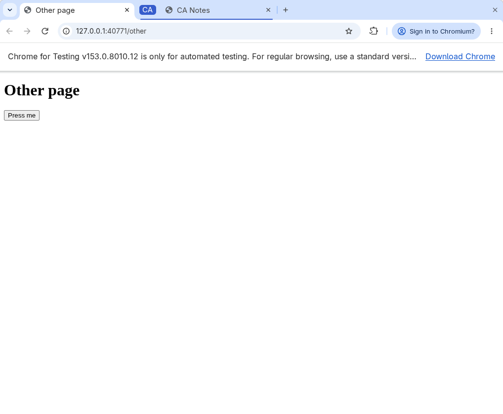
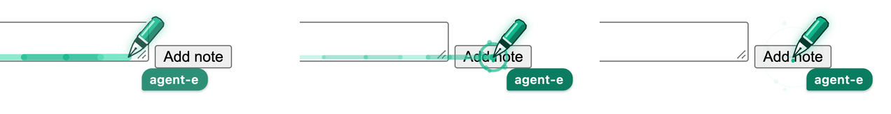
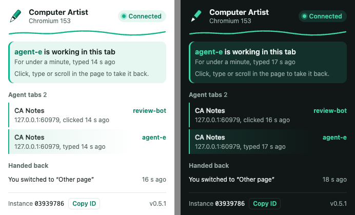

# Browser extension

The Computer Artist extension lets `ca browser` read and operate tabs in Chrome or
Chromium windows you already have open, in your own profile, while you keep using
the browser. Each browser profile with the extension installed becomes a
**browser instance** that `ca` can discover, select and drive.

Actions are DOM events inside the page, including a full mouse model for canvases
and drawing editors. `ca browser` never moves your pointer, never sends
operating-system input, never activates a tab or focuses a window, and never starts
a browser: agents work in the Chrome you already run.
Agents normally work in background tabs that they open themselves. This is
separation by design, not a security sandbox. The extension can read and change any
page it is allowed to script, and anything running as your user can reach the local
bridge.



## Install

From a checkout or an installed `computer-artist` package:

```bash
ca browser install          # registers the native host with detected browsers
```

The command does three things:

- It copies the extension to `~/.local/share/computer-artist/chrome-extension`
  (`$XDG_DATA_HOME` is respected).
- It writes a small launcher that runs the current Python with
  `computer_artist.browser_host`.
- It registers the native messaging host `com.computer_artist.browser` for every
  browser whose profile folder exists.

Pass `--browser NAME` (repeatable) to choose browsers, `--user-data-dir DIR` for a
browser started with a custom profile folder, and `--dry-run` to preview. The
launcher points at this checkout or environment, so keep it in place.

Then load the extension once in each browser:

1. Open `chrome://extensions` (or your browser's extensions page) and turn on
   **Developer mode**.
2. Choose **Load unpacked** and select the `extension_dir` that install printed.
3. Run `ca browser instances`. Each connected profile lists its instance ID.

After updating Computer Artist, run `ca browser install` again, then
`ca browser reload`: the running extension loads the installed files and comes
back within a second, keeping every claim. It refuses while another request is in
progress. Extensions older than 0.7.0 cannot reload themselves; press the reload
button on the extension card once. Keep **Developer mode** on: with it off, Chrome
disables an unpacked extension when it reloads. The extension's ID is fixed by the
`key` in its manifest (`fbbljgpbpgepkaimgbpcpemjdllnname`), so the host
registration keeps matching across reinstalls.

`ca browser doctor` checks the installed files, host registrations and connected
instances without changing anything. Install stamps a **build** (a digest of the
extension files) into the installed copy; `instances` and `doctor` report the
build each browser runs and warn `extension_reload_needed` when it differs from
the installed one, even when the version number is the same. A red **!** badge on the toolbar icon means
the extension cannot reach the native host; its tooltip gives Chrome's reason.

### Uninstall

```bash
ca browser install --remove
```

This removes the host registrations, launcher and extension copy that install
wrote. Manifests it did not write are kept. Then remove the extension card in
`chrome://extensions`.

### Packaged copy

```bash
ca browser package --output dist
```

This writes `computer-artist-chrome-extension-VERSION.zip` byte for byte the same
way every time and reports its SHA-256. Unzip it and use **Load unpacked**. Chrome
installs packaged extensions from outside the Web Store only through enterprise
policy. The extension is not published to the Web Store. The browser still needs
`ca browser install` for the native host.

## Use

```bash
ca browser instances                          # IDs, labels, windows, tab and claim counts
ca browser label work --instance 1a2b3c4d     # name an instance for later --instance work
ca browser tabs --instance work               # handles INSTANCE:TAB, active state, claims
ca browser open http://localhost:5173 --instance work --owner agent-a
#   -> {"handle": "1a2b3c4d:812", "lease": "...", "active": false, ...}
ca browser locate --tab 1a2b3c4d:812 --role textbox
ca browser type  --tab 1a2b3c4d:812 --lease LEASE --ref k3x9q2-1 "hello"
ca browser click --tab 1a2b3c4d:812 --lease LEASE --text "Save"
ca browser wait  --tab 1a2b3c4d:812 --text "Saved"
ca browser read  --tab 1a2b3c4d:812 --selector main
ca browser drag  --tab 1a2b3c4d:812 --lease LEASE --selector canvas --from 40 60 --to 160 60
ca browser navigate --tab 1a2b3c4d:812 --lease LEASE --reload
ca browser close --tab 1a2b3c4d:812 --lease LEASE
```

Agents start with `ca browser instances` and work in a connected browser, in tabs
they open next to yours. ca has no command that starts a browser. With no instance
connected, `instances` adds a `hint` and other commands refuse with `no_instances`:
the agent tells you, and starts a new browser only after saying so and with your
agreement, never silently.

Targets are always explicit. A tab handle carries its instance. With several
instances connected, a bare tab ID or `instances`-wide command without
`--instance` is refused (`ambiguous_instance`) rather than guessed. Elements are
chosen by `--ref` (from `locate`), `--selector`, `--text` (label or visible text)
or `--role` with `--name`. Several matches are refused with candidates unless you
pass `--first`. Refs belong to one page load and are refused as `stale_element`
after navigation or removal.

Every reply is JSON. Refusals use `{"ok": false, "error": CODE, "detail": ...}`
and exit with status 1.

### Native selects

`ca browser locate --tab H --selector select` lists exact option values, labels,
selected state and disabled state. Use `ca browser select --tab H --lease L
--selector '#colour' blue` to choose one exact value in a native single select.
This explicit DOM control sets the selection without opening a native popup and
emits bubbling `input` then `change`, only if the selection changes. It uses the
same lease, pen and human-interruption guard as other actions. Missing/ambiguous
values, disabled options/optgroups/controls and multiple selects are refused.
Events remain untrusted; trusted-gesture requirements are unchanged.

### Pointer, coordinates and frames

`click`, `move` (hover), `drag` and `scroll` act at an element's centre or at a
point. All coordinates are CSS pixels:

- With an element (`--ref`, `--selector`, `--text`, `--role`), `--x`/`--y` and the
  `drag` points are offsets from the element's rendered top-left corner. ca scrolls
  the point into view first.
- Without an element they are top-viewport coordinates, which must be inside the
  viewport (`point_outside_viewport` otherwise).
- `ca browser screenshot` reports `viewport` and `scale`, the screenshot pixels per CSS
  pixel (device pixel ratio times browser zoom). A point at image pixel (px, py) is
  `--x px/scale --y py/scale`. `locate` rects are top-viewport CSS pixels as well.

```bash
ca browser click --tab H --lease L --selector canvas --x 120 --y 80
ca browser click --tab H --lease L --x 640 --y 312 --count 2          # viewport point, double
ca browser click --tab H --lease L --text Item --button right --modifiers Shift
ca browser drag  --tab H --lease L --selector canvas --from 20 30 --via 100 30 --to 150 120
ca browser scroll --tab H --lease L --selector '#list' --delta 400   # wheel; positive is down
ca browser move  --tab H --lease L --text Menu                       # hover only
```

The events follow a real mouse: pointer and mouse boundary events as the pointer
enters elements (many toolbars ignore a press without a preceding hover), a move
before each press, `pointerdown`/`mousedown`, focus, `pointerup`/`mouseup`, and
`click` on the common ancestor, with `dblclick`, `contextmenu` and `auxclick` where
a real mouse sends them. A cancelled `pointerdown` suppresses the compatibility mouse
events and keeps focus where it was, as in Chrome. Drags move in steps of at most 8 CSS pixels, at frame rate in a
visible tab and without throttling in a background tab (`--interval` sets a delay).
An unhandled wheel scrolls the nearest box under the point that can still move that
way, or the page, and stops at a box with `overscroll-behavior: contain`. Clicks and
drags on disabled controls are refused, as Chrome never activates them.

Points hit-test through same-origin iframes, CSS-scaled frames and open shadow roots
to the element a real pointer would reach. `--frame SELECTOR` (repeatable for nested
frames) finds `--text`, `--selector` and other targets inside a same-origin iframe
for any command, including `read`, `locate` and `wait`. When a target exists only in
a frame, `locate` lists the frames that match and actions refuse with the `--frame`
flags to pass. Frames from another origin are refused as `cross_origin_frame`.
Elements named only by a tooltip (`title`) or `aria-label`, like icon toolbar
buttons, match `--text`.

When the user takes over in the middle of a drag, ca sends `pointercancel`, releases
nothing else and refuses with `ownership_revoked` and `gesture: cancelled`.

Pointer coordinates, gestures and frames need extension 0.6.0. With an older
extension running, the CLI refuses them as `extension_outdated` instead of letting
the old extension click an element's centre.

### Screenshots without switching tabs

`ca browser screenshot --tab H out.png` captures a tab without switching to it. A
tab Chrome is painting (the active tab of a window that is on screen) is captured as
displayed (`method: visible_tab`), spaced to stay within Chrome's rate of about two
such captures a second. Any other tab, in the background, in a minimized window, or
in a window that is covered or behind another application (Chrome stops painting
those and would return a stale frame), is rendered through Chrome's debugger
protocol without being shown (`method: debugger`), including canvases and iframes.
It never sends input that way. The user's tab and window stay in front.

Background rendering needs a claim on the tab (`open` or `claim`); an unclaimed tab
that is not on screen is refused as `claim_required`. A tab Chrome will not attach
to (another extension's debugger is attached, or a browser page) is refused as
`capture_unavailable`.

#### Debugger sessions

While any extension debugs a tab, Chrome shows **"Computer Artist" started debugging
this browser** with a Cancel button above the page in every window. The bar pushes
page content down by about 56 pixels, and Chrome keeps it about 5 seconds after the
last detach. Attaching for each capture made it appear and disappear repeatedly.

So the claim is the agent's **session** on a tab. Its first background screenshot
attaches the debugger to that tab, and it stays attached for the rest of the claim.
It detaches when the session ends:

| Session ends | How |
| --- | --- |
| The agent ends it | `close` or `release` |
| The agent forgot it | `ca browser cleanup --owner NAME` |
| The user takes the tab | click, key, scroll or touch in the page (`human_input`) |
| The tab goes away | closed or replaced |
| The agent stopped or crashed | 5 minutes without any request using the lease; the claim and its pen stay, and the next background capture attaches again |
| The extension reloads or Chrome exits | Chrome detaches everything; on startup, sessions of surviving claims are kept and any other leftover is detached |

So the bar appears at most once per session and goes away only after the last
session ends: several agents with sessions share one bar. `ca browser status`
reports `debugger_attached` for a tab, `ca browser instances` reports
`debugger_sessions`, and screenshots report `debugger_attached`. If you press
**Cancel** on the bar, Chrome detaches every session, and ca refuses further
background captures for those claims (`capture_unavailable`, `stop_reason:
debugging_cancelled`) instead of bringing the bar back; a new claim may attach again.

A background tab keeps the viewport size it last had on screen until it is shown
again, so its screenshots keep one size for the session. Each reply reports
`viewport` and `scale`; take coordinates from the latest screenshot.

#### The pen in screenshots

The pen is never hidden from the user (see [What you see](#what-you-see)). A shown
tab is captured as the user sees it, pen included (`pen: included`, with `pen_rect`,
an approximate box in viewport CSS pixels that covers the pen and its name tag).
A background rendering leaves the pen out (`pen: excluded`): the pen is hidden only
for that capture, in a tab nobody can see, and returns as soon as the tab is shown.
`pen: none` means the tab has no pen. Clicks and DOM reads never hit the pen.

This uses the `debugger` permission, listed by Chrome as "Access the page debugger
backend". Adding the permission to an unpacked extension needs one reload of the
card and no further prompt.

### The agents' window

`ca browser open URL --agent-window` opens the tab in a window of its own, created
unfocused on first use and reused for later tabs. Chrome keeps the user's window
focused and active tab unchanged. Agent tabs there are the active tab of a shown
window, so they render at full speed (timers and animation frames run) and capture
as displayed. Closing the window's last tab closes it.

### Focusing a tab

`ca browser focus --tab H --lease L` activates a claimed tab and focuses its
window, restoring it if minimized. It is the only command that switches tabs or
focuses a window, and it takes keyboard focus from whatever the user was doing.
Use it only for visible testing or when the user's attention is wanted, never for
background work. Activation keeps every lease, like the user switching tabs.

### Tab claims

A tab must be claimed before ca changes it: `open` claims the new tab, and `claim`
takes an existing one. The claim returns a **lease** that `navigate`, `click`,
`type`, `select`, `press`, `focus`, `release` and `close` require. Reads (`tabs`, `read`, `locate`,
`wait`, `screenshot`) need only the tab handle. `tabs` marks pages Chrome does not
let extensions script with `scriptable: false` and a `restriction`
(`browser_page`, `web_store`, `file_access_off`, `unsupported_url`); `claim` refuses
them as `page_unavailable` with the same reason. A claimed tab shows a green **CA**
badge on the extension icon. Tabs that ca opened also sit in a green **CA** tab group.

| Lease ends | `stop_reason` |
| --- | --- |
| You click, press a key, scroll or touch inside the tab | `human_input` |
| The tab closes or Chrome replaces it | `target_closed`, `target_replaced` |
| `ca browser release` | none, the claim is simply gone |

Tab activation and browser window focus are observation: they preserve the watched
claim and all other tabs. Trusted page input revokes only the tab receiving it.
Hover and page focus events do not count as takeover.

Input while the agent's pen is still moving to its target also counts: the action
is refused with `ownership_revoked` (`human_input`) instead of performed.

A revoked lease is refused with `ownership_revoked` and its stop reason. A
different lease is refused with `lease_mismatch`, and a second claim with
`tab_claimed`. `ca browser status --tab H --lease L` reports which of these
applies. ca only closes tabs it opened and you have not used since; releasing such
a tab and claiming it again keeps it closeable. Claims live in the extension's local
storage: they survive the native host restarting and the extension reloading or
updating (the human-input watcher is renewed in claimed tabs), and end when the
browser exits. A claim is restored only for a tab that still shows the URL it was
claimed at.

The CLI records each lease it receives in an owner-only folder
(`~/.local/share/computer-artist/leases`). An agent that lost track of its tabs runs
`ca browser cleanup --owner NAME`: tabs that owner opened are closed and tabs it
claimed are released, through their own leases. Claims that already ended are
reported as `ended` with whether the tab is still open. Other owners' tabs are never
touched. If the native host restarts during a command, the CLI waits for it to
reconnect and resends the request when that is safe: always when it was never
delivered, and only for reads otherwise.

Human input is detected from trusted page events by `watch.js`. This small content
script runs at document start in every frame of every page and sends only the
event type to the extension. It is injected into already-open documents when a tab
is claimed. The extension cannot see clicks in the browser's own toolbar or
address bar, so typing a URL into a claimed tab's
address bar is not detected. Tab activation alone is allowed; browser-toolbar
input is outside this page-input guard.

### What you see

A tab an agent claims shows its pen from the moment of the claim until the claim
ends, also in each page it navigates to and after an extension reload. A pen means
an agent is working in that tab; no pen means the tab is yours. When you watch a
tab an agent is working in, its pen moves through the page. This
is the native ink pen from computer use, drawn in green Chrome ink with the owner's
name beside it, so you can tell browser control from computer use at a glance. The
blue pen is computer use. The green pen and its name tag mean Chrome DOM control.
The pen glides to each target before ca clicks, types or presses a key, splashes
on clicks, writes along fields and drips at rest; before the first action it rests
near the top right corner. When the claim ends, it shows **Back to you** and lifts
away; in a tab you are not looking at it is removed at once. In a background tab ca
acts without the glide. If
you switch to that tab, its agent keeps working and you can watch the pen. The pen is drawn above the page's dialogs, ignores the pointer and holds no
page text, so `read`, `locate` and the obscured-click check do not see it.
`ca browser screenshot` of a tab on screen includes it; background renderings leave
it out (see [the pen in screenshots](#the-pen-in-screenshots)). With reduced motion
turned on, it moves without animation.



Click the toolbar icon for the status card. It shows whether the extension
reaches ca, with Chrome's reason and the fix when it does not. It also shows
who controls the tab you are looking at, every tab an agent holds now with its
latest action, and why recent claims ended, for example **Your input in "Example Domain"**. The card only reads state the extension already keeps; it
never acts on tabs. Copy the instance ID from its footer for `--instance`.



## Limits

- **Input is untrusted DOM events.** Page scripts see `isTrusted: false`. Sites
  that require trusted gestures, such as popups, clipboard access, fullscreen or
  file pickers, refuse them. Keys other than Enter (submit or activate) and
  Backspace/Delete in text fields have no default action, and synthetic events do
  not change CSS `:hover`, open native menus or start native drag and drop. ca does
  use the `debugger` permission only to render background screenshots, never for
  input, so there is no trusted input. Measured on 4 November 2026, the full mouse model edited Marvin JS
  and the LabServant canvas structure editor exactly like trusted input; see the
  [precise input record](validation/2026-11-04-chrome-precise-input.md).
- **Background screenshots render the viewport only**, at the tab's window size,
  and need the `debugger` permission (0.7.0) and a claim (0.8.0). Chrome shows its
  debugging bar while a session is attached; branded Chrome cannot hide it for an
  installed extension. Pages that block extension debugging are refused as
  `capture_unavailable`.
- **Scriptable pages only.** `chrome://` pages, the Web Store, other extensions'
  pages and, unless you allow file access on the extension card, `file://` URLs
  cannot be claimed or read. Same-origin iframes are reachable with `--frame` and
  by point; frames from another origin are not.
- **Branded Chrome 137 and later** ignore the `--load-extension` command-line flag.
  Load the extension through the extensions page as described above.
- Requests are capped at about 900 KB (Chrome's 1 MB native-message limit), typed
  text at 100,000 characters and replies at 64 MiB.

## How it works

```
ca browser ──(same-user socket, mutual HMAC)──> native host ──(stdio)──> extension service worker ──> tab
```

- **Extension** (Manifest V3, `computer_artist/chrome_extension`). Each action runs
  as one script in the tab's top frame, so a drag of any length is one round trip. Its permissions
  are `nativeMessaging`, `debugger` (background screenshots only, one session per claim), `tabs`, `scripting`,
  `storage`, `alarms` and `tabGroups`,
  with host access `<all_urls>` and the `watch.js` content script. `pen.js` is
  injected only into the top frame of a claimed tab, when it is claimed and in each
  new document. The popup
  reads bridge state from session storage and claims from local storage. The service worker connects to the native host at
  startup, and that open port keeps it running. It reconnects with backoff after a
  disconnect and checks every minute from an alarm.
- **Native host** (`computer_artist/browser_host.py`). Chrome starts one per
  connected profile. The host binds an endpoint and publishes it as
  `INSTANCE.json` in the rendezvous folder: `$XDG_RUNTIME_DIR/computer-artist/browsers`
  on Linux, otherwise `~/.local/share/computer-artist/browsers`. When Chrome
  closes the port, the host removes its record and exits.
- **Endpoint and authentication.** Linux and macOS use a Unix socket in the
  owner-only (0700) rendezvous folder. Windows uses loopback TCP, because CPython
  has no `AF_UNIX` there. Both ends prove the per-user 32-byte key in `key`
  (mode 0600) with a mutual HMAC challenge before any request. The key never
  crosses the connection. No port is reachable from other machines, and web pages
  cannot speak the protocol.
- **Identity.** The extension stores a random 8-character instance ID and your
  label in `chrome.storage.local`. They persist across browser restarts.
  Unreachable records are pruned during discovery.

The bridge is independent of any other browser agent. It does not use
ChatGPT/Codex browser-access credentials, Chrome remote debugging, or a TCP port
open to the network.

## Platforms

| Platform | Status |
| --- | --- |
| Linux (Fedora 43, GNOME Wayland) | Verified on 3 November 2026 with Chrome for Testing 153, headless and headed in a private KWin desktop. See the [validation record](validation/2026-11-03-chrome-extension.md). |
| macOS | Unix socket, `~/Library/Application Support/<browser>/NativeMessagingHosts`. Debugger sessions and the session pen were verified on 5 November 2026 in the user's Chrome 156; see the [debugger session record](validation/2026-11-05-chrome-debugger-session.md). The pen, status card and takeover were verified on 3 November 2026 with headless Chrome for Testing 153 on macOS 27; see the [pen and status card record](validation/2026-11-03-chrome-pen-status.md). |
| Windows | Implemented (loopback TCP plus key, `HKCU\Software\<vendor>\NativeMessagingHosts`) for Chrome, Chromium, Edge and Brave; covered by portable tests, not exercised with a real browser |

The folder names for Chrome Beta, Dev and Canary, Brave, Edge and Vivaldi follow
each vendor's convention but have not been tested. On Windows, Vivaldi and the
Chrome channels other than stable are not registered.
