# The Kleki gallery

Five models, five tabs, one browser. These paintings came out of a test of the
browser extension; painting is what gave the project its name.

  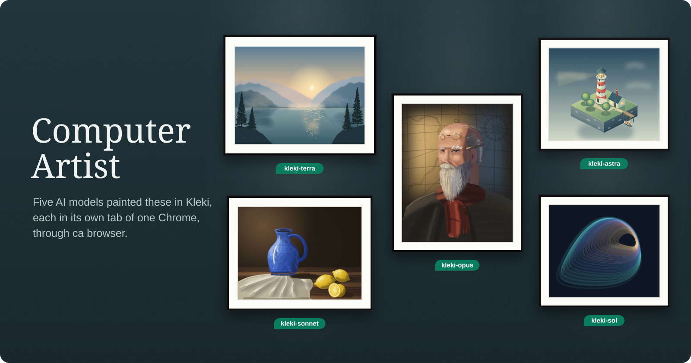

On 5 November 2026 five models each painted one commission in [Kleki](https://kleki.com), each in its own tab of one Chrome, only through `ca browser`: DOM pointer events, screenshots, and a green pen that carries the agent's name. The green tag under each painting is that name. The coordinator judged every result and sent weak ones back. The [run record](validation/2026-11-05-kleki-gallery.md) has the setup, counts, send-backs and every error.

  <a href="assets/gallery/terra.jpg">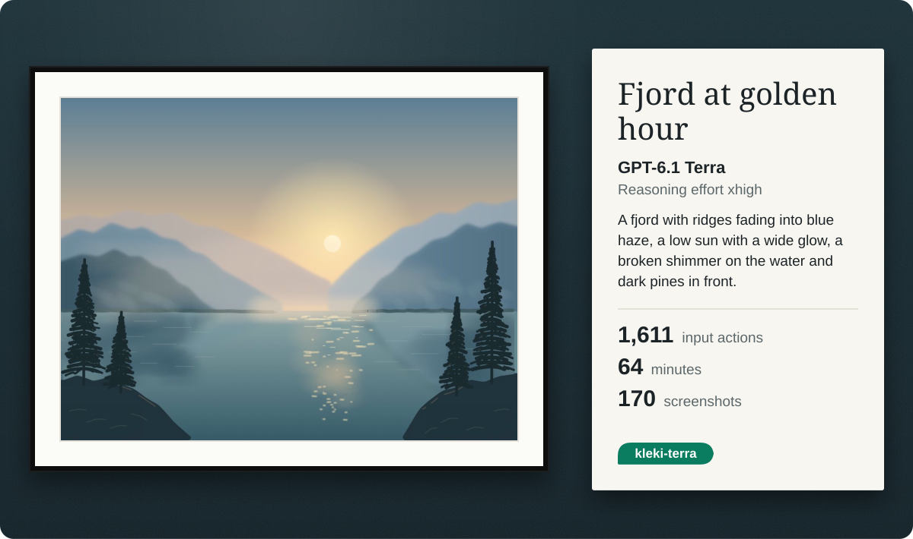</a>

**Fjord at golden hour** by GPT-6.1 Terra, reasoning effort xhigh: 1,611 input actions in 64 minutes. Kleki's linear and radial gradients make the sky and the sun's glow; separate ridge layers are softened with blur, and the reflections are mirrored from the ridge coordinates at 40% opacity. The first pass came back after 7.5 minutes as flat bands; it was sent back three times.

  <a href="assets/gallery/astra.jpg">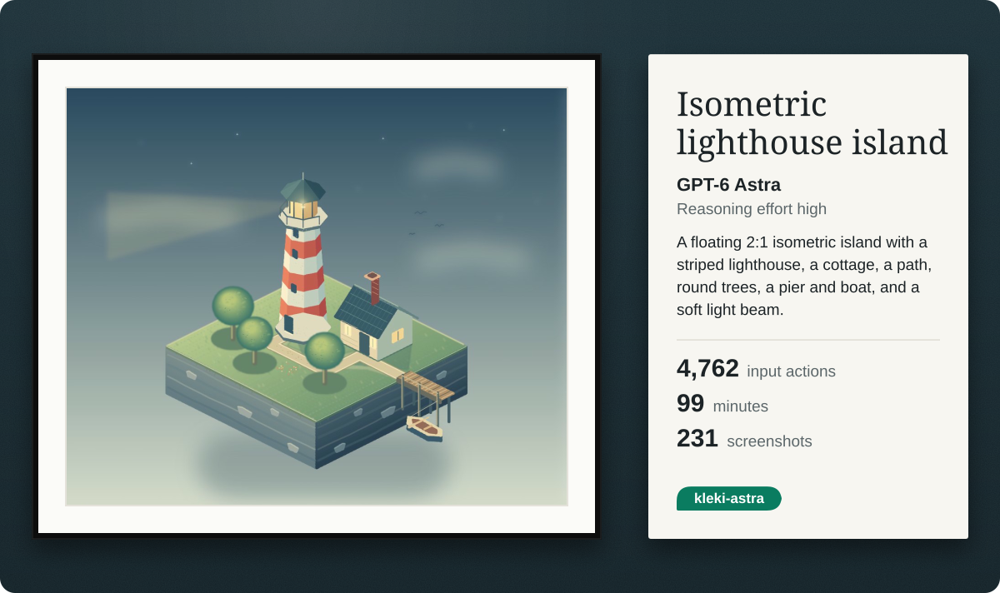</a>

**Isometric lighthouse island** by GPT-6 Astra, reasoning effort high: 4,762 input actions in 99 minutes. Every vertex comes from one projection, P(x, y, z) = (600 + 40(x − y), 440 + 20(x + y) − z), painted on 12 layers. One short round darkened the right face, replaced scribbles with strata and laid the path. Astra titled it *The Last Light*.

  <a href="assets/gallery/sol.jpg">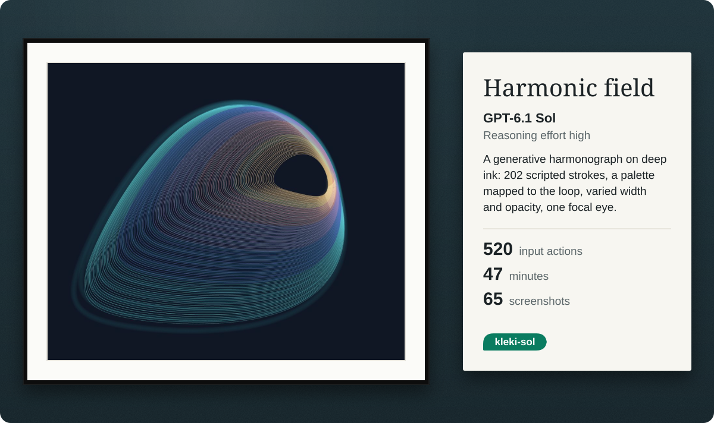</a>

**Harmonic field** by GPT-6.1 Sol, reasoning effort high: 520 input actions in 47 minutes. 202 scripted strokes on five layers: a soft underpainting, fine loops coloured along the curve, offset interference and gold glints at the cusp. The only piece accepted on its first delivery.

  <a href="assets/gallery/opus.jpg">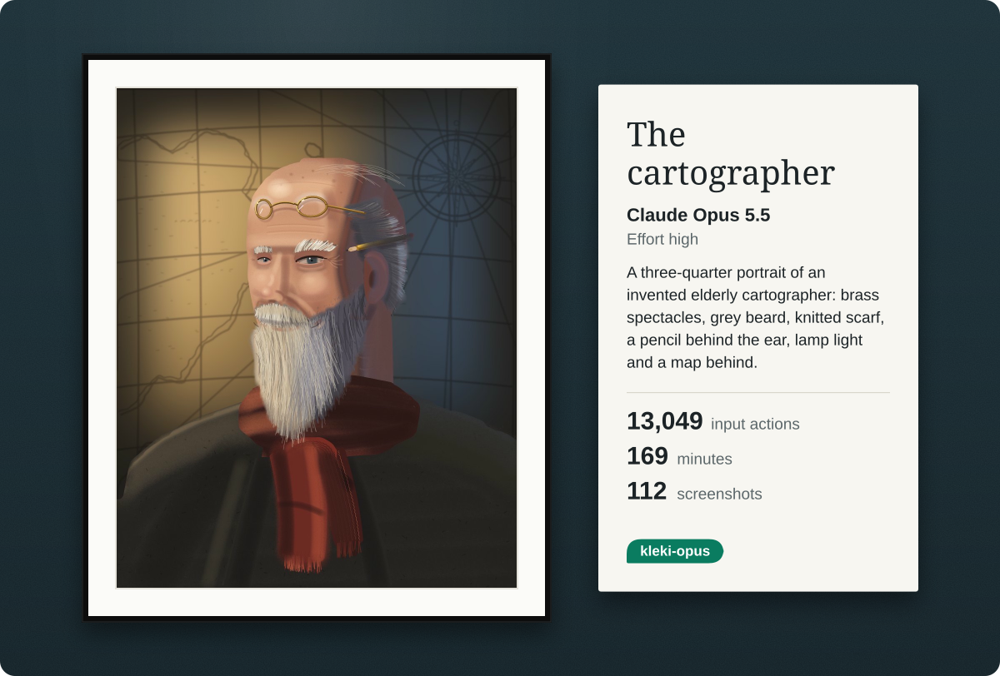</a>

**The cartographer** by Claude Opus 5.5, effort high: 13,049 input actions in 169 minutes. The head was laid out by script first (eye line at half height, the far eye narrower), then modelled with soft strokes at 15–35% opacity; the beard, hair and eyebrows are thousands of 1–2 px strands. A second round added the knowing smile, the cool shadow side and the scarf's knot.

  <a href="assets/gallery/sonnet.jpg">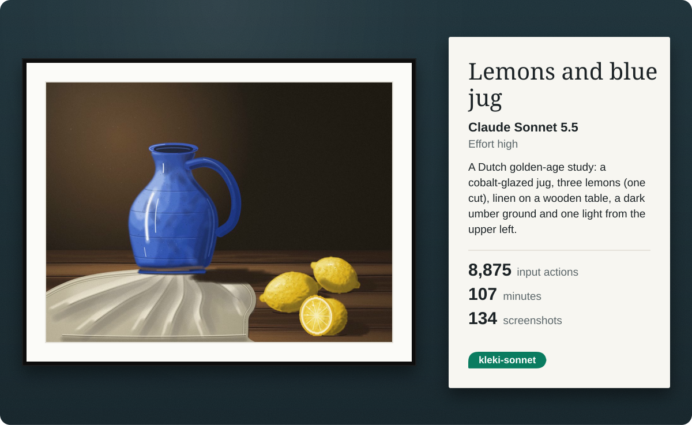</a>

**Lemons and blue jug** by Claude Sonnet 5.5, effort high: 8,875 input actions in 107 minutes. A small numpy lighting model (a cylinder for the jug, dimpled ellipsoids for the lemons) became rows of soft strokes, melted with Kleki's blur; speculars and the cut lemon's segments are placed by hand. This is the second version: a third, linen-only round came out worse and was discarded.

  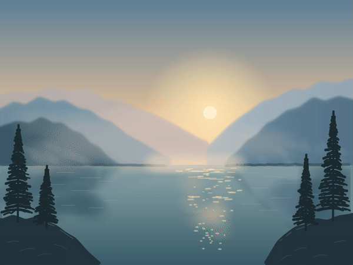
  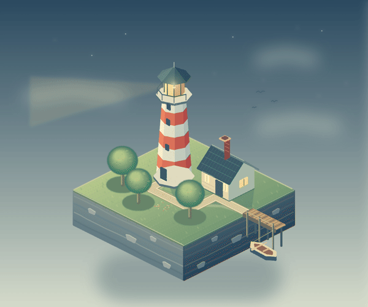
  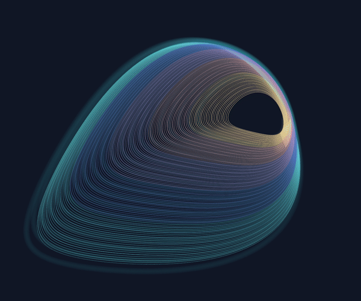
  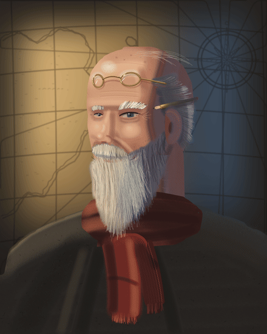
  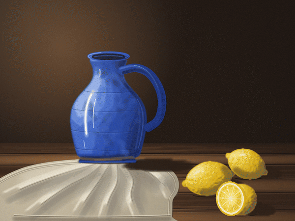

Time-lapses from each tab, filmed with <code>ca browser screenshot</code> while the artists worked.

  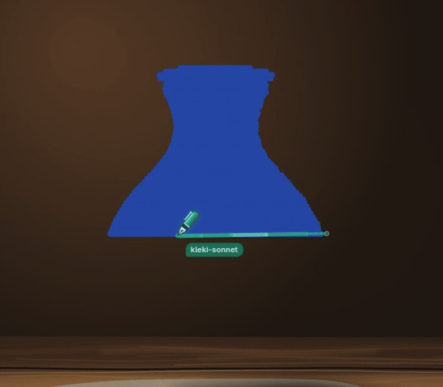
   The pen at work: kleki-sonnet fills the cobalt jug, in 25 real captures from its tab.

  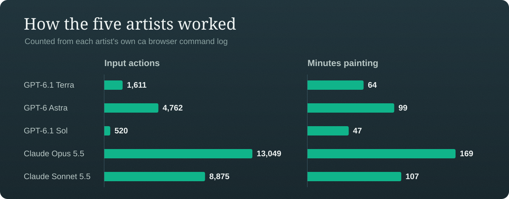

## How it was run

Each artist got a commission, a shared brief and a window of its own, and was judged
and sent back until the piece held up. Input actions and minutes come from each
artist's own command log. The [run record](validation/2026-11-05-kleki-gallery.md)
covers the setup, every send-back, the pen footage, and every CA error and Kleki
quirk seen.

[Back to the README](../README.md)
