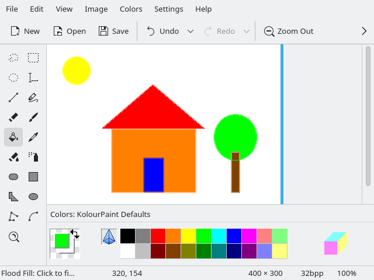

# Painting workflow memory: observed result

On 29 October 2026, two separate clean-slate GPT-6.1 Terra agents (high effort,
priority service) completed the same request in a private KolourPaint environment:

> Draw a colorful little house with a triangular red roof, blue door, yellow sun
> and green tree on a white background, using actual painting tools/strokes.

The first agent discovered the controls, drew the composition, inspected its
result and learned `colourful-house`. The second received the same request and
access to the memory library, without the first agent's conversation, benchmark
source or screenshots. It searched, read the memory, observed the fresh app,
ran the remembered procedure and visually inspected the result.

| Measurement | First: discover and learn | Second: retrieve and reuse |
| --- | ---: | ---: |
| Agent wall time | 53.908 s | 19.545 s |
| Of which learning | 0.567 s | — |
| Successful painting program | 4.249 s | 4.345 s |
| Painting attempts before success | 3 | 1 |

The second took **63.7% less time (2.76× faster)** for this pair. Execution speed
was essentially unchanged; the saving came from avoiding control discovery and
repairs. Both agents used real pointer input in KolourPaint, rather than importing
an image or drawing directly into its image file.

## Conditions and limits

- Both started with an untitled white 400 × 300 canvas at 100% in a 640 × 480
  window. The bottom of the canvas extended below the viewport; the entire
  requested composition fit in the visible part. The second used a fresh app
  process/window. Tool selection differed, and the stored procedure explicitly
  selected each tool and colour before using it.
- Setup, reading the general skill and resetting the app were excluded from
  both timers. Discovery/retrieval, drawing, retries and visual inspection were
  included. The first total includes learning. Report-writing after verification
  was excluded from both.
- The first monotonic measurement failed across tool processes. Its elapsed
  time was reconstructed from host marker-file timestamps. The second used
  host marker modification nanoseconds, with wall-clock nanoseconds as a cross
  reference. These are observed wall times, not a controlled performance study.
- The first had an ambiguous accessibility match and an incorrect pixel-change
  check before success. Avoiding those mistakes is part of the measured benefit.
  One pair establishes this workflow's reuse benefit, not general app coverage.
- Program checks establish a fresh pixel change. Each agent separately inspected
  the screenshot for the requested features; the check itself is not proof of
  the image's semantic correctness.
- This validates the private Linux/KWin painting journey from a macOS host.
  Native macOS/Windows memory execution and changed app layouts were not tested.
  A redesigned toolbar still needs agent adaptation using the stored notes.

Raw timings and retry details: [first](evidence/workflow-memory/first.json),
[second](evidence/workflow-memory/second.json). The
[learned program](evidence/workflow-memory/learned-program.txt) is a record of this
particular UI, not a universal KolourPaint layout.

## Focused feature verification

After timing, the second agent also exercised a short
[feature journey](evidence/workflow-memory/feature-journey.json):

- Reusing the drawing on its modified document title was refused before input
  (zero successful input replies in the trace).
- A real chimney stroke with `execute --remember` created a searchable executable
  memory after its check passed and the agent visually inspected the stroke.
- An observation-only, unverified execution returned `memory_error` and left the
  existing memory revision and source unchanged.

The private environment was stopped, and the local workflow library was retained.
Lint, formatting and wheel packaging passed. No new unit tests or broad local
suite runs were added for this hobby feature; existing CI remains the merge gate. Its pre-existing asynchronous export test
needed a wider stability window after two macOS scheduling races; production
export behavior was unchanged.

Cross-reviewed: 3 rounds with GPT-6.1 Terra. Verdict: APPROVE. C1 (native app
identity missing from the reuse guard) was fixed; subsequent rounds approved it
and a 1e-6-pixel tolerance for compositor floating-point roundoff. No findings
were declined. Native input backends were outside the review's change scope.
