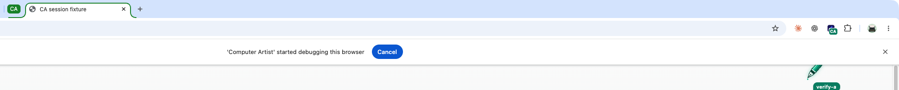

# Chrome debugger sessions, the session pen and the running browser (5 November 2026)

Host: macOS 27 (Apple Silicon), the user's own Google Chrome 156 with extension 0.8.0
(instance `5cb4db89`), while other agents were working in the same browser. All
proof ran in tabs this record's agents opened (owners `verify-*`) next to the user's
tabs, against a localhost fixture page; nothing else was touched.

## Problems

1. Each background screenshot attached Chrome's debugger and detached it again.
   Chrome then showed and removed **"Computer Artist" started debugging this
   browser** above every window. Each time the bar appeared, page content moved down
   about 56 pixels, so coordinates taken from screenshots stopped matching.
2. The pen appeared only once an action ran, and screenshots hid it, so a user could
   see an agent's tab without a pen, or see the pen blink out.
3. Agents sometimes started a new browser instead of using the running Chrome.

## Decisions

- **The claim is the session, per tab.** `open` or `claim` starts it; `close`,
  `release`, `cleanup`, human input in the page, or the tab closing ends it. The
  first background screenshot attaches the debugger to that tab and it stays
  attached until the session ends. A session per tab matches Chrome's per-tab
  attachment and the existing lease. No new command is needed.
- **Safe release.** A session without any request using its lease for 5 minutes
  detaches by itself; the claim and pen stay until the agent or user ends them.
  Chrome detaches everything on extension reload or exit; on startup, sessions of
  surviving claims are adopted and other leftovers detached. If the user presses
  Cancel on the bar, ca stops rendering those claims in the background
  (`debugging_cancelled`) instead of bringing the bar back.
- **Background rendering needs a claim.** Unclaimed tabs that are not on screen are
  refused as `claim_required`, so ca never attaches to the user's own tabs.
- **The pen is always visible to the user.** It is shown from the claim on, again in
  every new document and after extension reloads. A shown tab is captured as the user
  sees it, pen included (`pen: included`, with `pen_rect`). A background rendering
  hides the pen for the capture only, in a tab nobody sees (`pen: excluded`). pen.js
  refuses to hide it in a visible page and restores it the moment a tab becomes
  visible. Hiding it from a visible-tab capture without the user seeing a flicker is
  not possible: captureVisibleTab copies what is on screen.
- **Rapid captures of shown tabs are spaced** to stay within Chrome's two-a-second
  limit instead of falling back to the debugger.
- **ca never starts a browser.** The skill tells agents to run `ca browser instances`
  first and work there. With nothing connected, `instances` adds a `hint` and
  `no_instances` says ca starts no browser and that a new one needs the user's
  agreement.
- A tab ca opened stays closeable after a release and a new claim, until the user
  uses it. Found during this run, when a re-claimed fixture tab could not be closed.

## Live run in the user's Chrome

A sampler captured the user's Chrome window every 250 ms and detected the bar.
Timestamps are seconds from the first open.

| Scenario | Bar appeared | Session(s) ended | Bar gone |
| --- | --- | --- | --- |
| One agent, 5 background screenshots over 9 s, then `release` | 0.4 (first capture) | 9.7 | 14.8 |
| Two owners, 3 parallel screenshots each; B closed, then C closed | 18.9 | B 19.9 (bar stayed, C still attached), C 21.8 | 26.9 |
| Agent never closes; `ca browser cleanup --owner verify-d` | 29.2 | 29.9 | 34.9 |

The bar appeared once per run and stayed on through every screenshot. It left only
after the last session ended. Chrome keeps it about 5 seconds after the last detach.

- `status` reported `debugger_attached: true` from the first capture to the end and
  `false` afterwards; `instances` reported `debugger_sessions` 2 with both owners
  active, then 1, then 0.
- The pen was present (`locate ca-agent-pen` visible) right after `open`, between all
  captures, for both owners at once, and after a re-claim; it was gone (count 0)
  1.6 s after `release`.
- A background capture of the released tab was refused as `claim_required` with no
  session attached.
- During the single-agent run, Chrome made the agent's tab active from outside ca,
  probably because another tab or the user's action changed the active tab. Two
  captures then ran as `visible_tab` with `pen: included`, and the window capture
  shows what the user saw: the bar with the pen and its owner tag.

A separate probe opened a background tab and took a screenshot. It then polled the
active tab every 200 ms for 6 s, twice: ca never activated the agent tab. Another
thread's agents were opening and activating their own tabs in the same window at
the time.

**Forgotten session.** An agent (`verify-e`) opened a tab, took one background
screenshot and then sent nothing. Other agents also held sessions at the time, so the
bar was already showing. After 302 s (checked every 15 s), `status` reported
`debugger_attached: false` and `instances` reported `debugger_sessions` 0. The claim
was still held and its pen still showed. The bar left 5 s after the 300 s idle
detach, with no close.

## Regression run

`tests/integration/check-browser.py` (two headless Chrome for Testing 153 instances,
`TMPDIR=/tmp`) passed all 60 checks. These changed or were added:

- `shown_screenshot_includes_pen`: 881 teal pen pixels and `pen: included`.
- `background_capture_shows_iframe_canvas`: `pen: excluded`, no teal pixels, session
  attached.
- `concurrent_background_captures`: 2 sessions held at once.
- `rapid_visible_captures_are_spaced`: 4 simultaneous captures of a shown tab, all
  `visible_tab`, no debugger.
- `cleanup_closes_only_own_tabs`: the cleaned owner's session ended (2 to 1).

Unit tests: 246 run, 10 platform skips, all passing; lint and formatting passed.

## Not verified

- Pressing Cancel on the bar and human takeover in the real Chrome: they need the
  user's own input. Takeover is covered by the headless regression.
- Windows and Linux Chrome; branded Chrome only on macOS.
