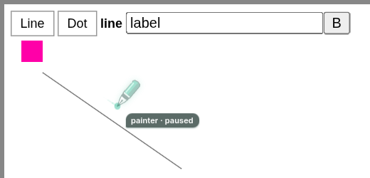

# Chrome: your input pauses the agent, and ca closes the tabs it opened (6 November 2026)

Host: Fedora 43, Chrome for Testing 153.0.8010.12 with extension 0.10.0, driven by
`tests/integration/check-browser.py`. Two disposable profiles ran headless, then
again headed in a private KWin desktop (`ca env start`, its own Wayland socket and
session bus). A small DevTools client stood in for the human, sending trusted
mouse, key and wheel input; ca itself never used DevTools. No user profile was
touched.

## Problems

1. A real click, key, scroll or touch in a claimed tab ended the agent's lease
   (`ownership_revoked`, `stop_reason: human_input`). An agent working next to the
   user lost its tab, its session and its pen whenever the user touched the page,
   and had to ask before claiming it again.
2. Whether ca could close a tab was recorded on the claim. After `open`, `release`,
   `claim`, `close` refused with `not_agent_tab`, although ca had opened the tab.
   `cleanup --owner` released such a tab instead of closing it.

## Decisions

- **Your input pauses, never revokes.** The worker records the latest trusted input
  per claimed tab. Every action that changes the page (`click`, `move`, `drag`,
  `scroll`, `type`, `press`, `select`, `navigate`, `close`) first waits until the tab
  has had 3 seconds without input, for at most 15 seconds or half the request's
  timeout. A reply that waited reports `human_waited_ms`. Past that budget the
  request is refused with `human_active`, `performed: false` and `retry_after_ms`,
  and the lease holds.
- **Interrupted before anything happened, the action runs again.** Input while the
  pen glides to its target refuses inside the page before any event is sent; the
  worker waits for the next pause and runs the action. A drag already pressed is
  cancelled with `pointercancel` and reported (`human_active`, `gesture: cancelled`,
  `moved`), because repeating a half-drawn stroke is the agent's decision.
- **Input in a frame counts for the tab.** Subframe input is relayed to the top
  frame, where actions and the pen run. Reads, `release` and `focus` never wait.
- **The pen shows the pause.** It fades and its tag reads **OWNER · paused**, grey
  instead of green, until 3 seconds after the last input.
- **The extension remembers which tabs ca opened**, and for which owner, for as long
  as each tab exists: across release and later claims, extension reloads (checked
  against the tab's URL after a browser restart, like claims) and Chrome replacing
  the tab. `close` needs a lease and that record; a tab the user opened is only
  released. `status` and `tabs` report `opened_by`, and `cleanup --owner` closes a
  tab whose `opened_by` is that owner.
- **No `close --owner`.** Cleanup already closes an owner's tabs through its recorded
  leases. Closing without a lease would close tabs that were released, which belong
  to the user.

## Results

Headless and headed runs both passed every check below; 68 of 69 checks passed in
each.

| Check | Evidence |
| --- | --- |
| `human_input_cancels_drag_and_keeps_lease` | A trusted click mid-drag: `human_active`, `gesture: cancelled`, `moved: 18`; `status` kept the lease, `human_active: true`, `human_input: pointerdown` |
| `pen_shows_pause` | Screenshot during the pause: 1,451 grey tag pixels, 0 green |
| `action_waits_for_human_pause` | The next click on the same lease waited 1,991 ms (headed) and 2,203 ms (headless), then acted |
| `pen_resumes_after_pause` | 846 green pen pixels again after the pause |
| `busy_human_refuses_with_lease_kept` | Wheel input every 300 ms against a 6 s request: refused after 2,802 ms with `performed: false`, `retry_after_ms: 2716`; the tool did not change and the lease held |
| `human_input_in_iframe_pauses` | A click in the page's iframe paused the tab; a hover then waited 2,400 ms and ran |
| `human_key_pauses` | A key in the top document: `human_input: keydown`, lease kept |
| `human_input_while_opening_keeps_claim` | Input while a tab opened: `open` succeeded with `human_active: true` |
| `human_input_pauses_only_its_tab` | A sibling tab acted at once, without `human_waited_ms` |
| `human_watch_live_after_reload` | After an extension reload, a click still paused the claim |
| `release_hands_tab_over` | Released tab: no claim, no group, `opened_by: giver` |
| `reclaimed_agent_tab_closes` | `open`, `release`, `claim`, `close`: closed |
| `cleanup_closes_reclaimed_agent_tab` | The same sequence through `cleanup --owner lender`: `close` |
| `close_refuses_user_tab` | `close` on a claimed user tab: `not_agent_tab`; `release` then succeeded |

## Limits

- `agent_window_unfocused_and_reused` failed in both runs, and on `main` before this
  change. Headless Chrome reported the new agent window as focused next to the
  user's window. Headed in KWin, the agent window took the focus from the user's
  window. `--agent-window` therefore takes focus on KDE Wayland; this record does
  not change that.
- The human was emulated through DevTools input in disposable profiles. The user's
  own Chrome and a person at the keyboard have not been tested with 0.10.0.
- Browser toolbar and address bar input stay invisible to the page watcher, so they
  do not pause the agent.
- A user can no longer take a tab back by clicking in it. They close the tab or ask
  the agent to release it.
